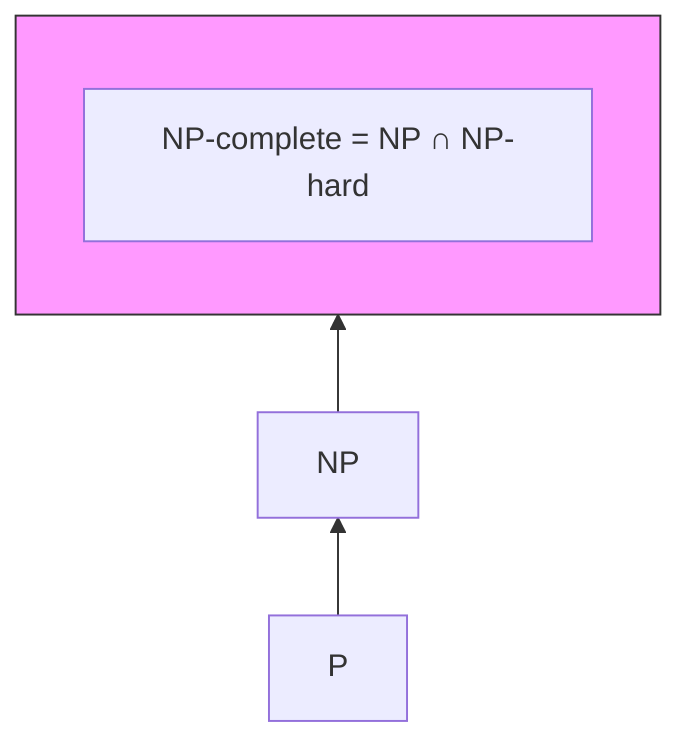

+++
title = 'Way to GLP'
draft = true
+++

# **Prerequisites**

## NP HARD

> :smiley_cat:The difficulty of a problem is measured from **two dimensions**: the difficulty of **solving** the problem and the difficulty of **verifying** the problem.

### Polynomial time

An algorithm is said to run in polynomial time if its **worst-case** running time for **a problem of size n** can be bounded by a polynomial function of n (e.g. n, n², n³, n log n, etc.).

### Nondeterministic polynomial time

> :herb:There is no emphasis on being difficult to solve

There exists a deterministic Turing machine (which can be understood as an algorithm) that can verify the correctness of this proof in polynomial time.

### NP Hard

A problem H is called NP-hard if and only if: Every problem L in NP can be reduced to H in polynomial time.

> :herb:It can be understood from two perspectives: one is **computable** **reduction** **function**, and the other is **base on NP.**

### NP Complete

NP-hard gives NP-complete problems the property of being difficult to solve, while NP gives NP-complete problems the property of being decidable.

### Some containment relations

> P ⊆ NP
> NP-complete = NP ∩ NP-hard
> NP-hard ⊇ NP-complete



## How does P≠NP ensure the reliability of cryptography?

It can also be summarized as the specific meaning of P≠NP in cryptography.

FNP!!

## SIS 

### Definition
Let $n$, $m$, and $q$ be positive integers, where $q$ is a prime modulus. The **Short Integer Solution (SIS)** problem is defined as follows:

- A uniformly random matrix $\mathbf{A} \in \mathbb{Z}_q^{n \times m}$
- A non-zero integer vector $\mathbf{z} \in \mathbb{Z}^m$ satisfying:
  
  ```math
  \mathbf{A} \mathbf{z} \equiv \mathbf{0} \mod q \quad \text{and} \quad \|\mathbf{z}\| \leq \beta

### Computational Hardness

The Short Integer Solution (SIS) problem is **computationally hard on average**, and its hardness is backed by **worst-case hardness assumptions** in lattice theory.

There exists a **polynomial-time reduction** from worst-case lattice problems such as **SIVP (Shortest Independent Vector Problem)** to SIS:

> :herb:If an algorithm can solve random SIS instances with non-negligible probability, then it can also be used to solve SIVP on any lattice in the worst case.

This connection means that SIS is **as hard as the hardest problems in NP (under lattice assumptions)**, and it provides strong theoretical evidence for the security of cryptographic schemes based on SIS.

# Introduction to GLP

## Proposal of algorithm

The GLP signature scheme was proposed in **2012** at the **CHES (Cryptographic Hardware and Embedded Systems)** conference.

Early lattice-based cryptographic schemes generally incurred high computational costs. The GLP scheme constructed an efficient, secure, and practical lattice-based signature algorithm that can be used in resource-constrained environments such as **embedded devices and smart cards.**GLP was one of the **first practical Ring-LWE-based signature schemes**, demonstrating that lattice cryptography could be used **on embedded systems.**

## Algorithm details

### Key Generation


### Signature and Verification

 


## Coding Demo: Signing & Verifying


# GLP in CTF challenges

### 2023 HackTMCTF


### 2023 D3CTF


# Sources of risk in GLP


# References

https://blog.maple3142.net/2025/04/27/fcsc-2025-writeups/#kzber

https://eprint.iacr.org/2018/381.pdf

https://link.springer.com/chapter/10.1007/978-3-642-33027-8_31

# Additional Ramblings

We need to be rigorous in defining each one to maintain a comprehensive understanding.

Dont be afraid to make mistakes,which important is learning new things from the error.